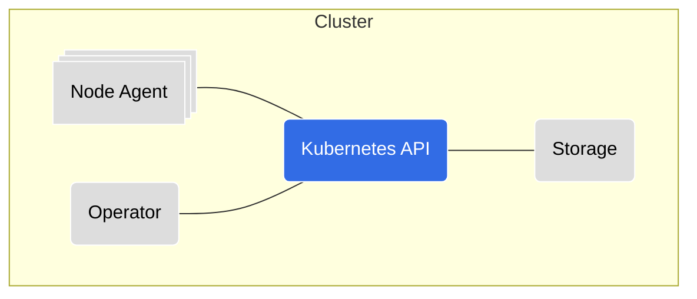
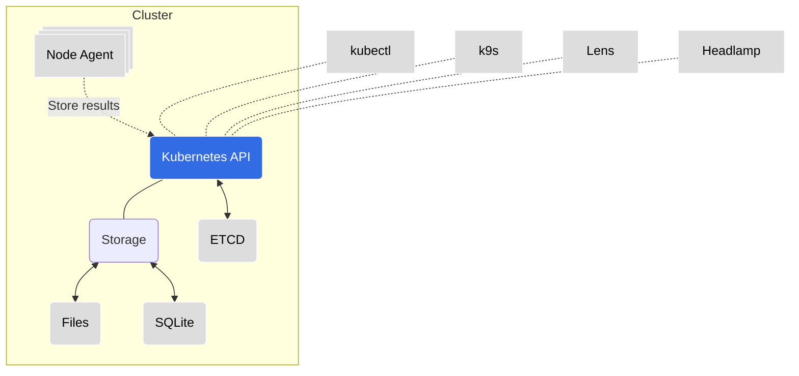
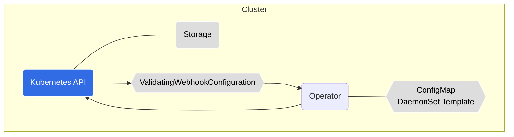
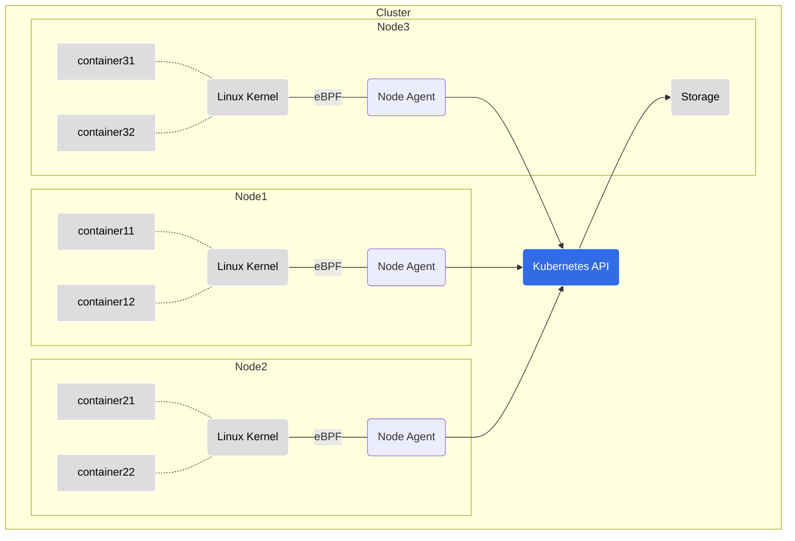

# Kubescape Operator

  

[Kubescape operator documentation](https://kubescape.io/docs/install-operator/)

## Install

> **Warning:** We only support installing this chart using Helm or ArgoCD.
Using alternative installation methods, such as Kustomize, Helmfile or using custom scripts, may lead to unexpected behavior and issues.
We cannot guarantee compatibility or provide support for deployments that are installed using methods other than Helm or ArgoCD.

When installing with ArgoCD or another GitOps controller that continuously re-renders Helm charts, set `certificates.strategy=initContainer` so the admission and storage certificates are generated and patched at runtime instead of during template rendering.

> **Migrating from `strategy: hook`:** The `hook` strategy was removed in favour of `initContainer`. Update your values from `certificates.strategy: hook` to `certificates.strategy: initContainer`.

Run the install command:

```
helm repo add kubescape https://kubescape.github.io/helm-charts/ ; helm repo update ; helm upgrade --install kubescape kubescape/kubescape-operator -n kubescape --create-namespace --set clusterName=`kubectl config current-context`
```

Verify that the installation was successful:

```shell
$ kubectl get pods -n kubescape
kubescape     operator-5d745b5b84-ts7zq                           1/1     Running   0               60m
kubescape     storage-59567854fd-hg8n8                            1/1     Running   0               60m
```

## View results

The node agent records the runtime behaviour of each container and stores it through the storage API.

View the recorded profiles:

```
kubectl get applicationprofiles -A
kubectl get networkneighborhoods -A
```

View the suggested network policies:

```
kubectl get generatednetworkpolicies -A
```

## Uninstall

You can uninstall this helm chart by running the following command:

```shell
helm uninstall kubescape -n kubescape
```

Then, delete the kubescape namespace:

```shell
kubectl delete ns kubescape
```

## Chart support

### Values

| Key | Type | Default | Description |
|-----|------|---------|-------------|
| global.networkPolicy.enabled | bool | `false` | Create NetworkPolicies for all components |
| global.networkPolicy.createEgressRules | bool | `false` | Create common Egress rules for NetworkPolicies |
| global.kubescapePsp.enabled | bool | `false` | Enable all privileges in Pod Security Policies for Kubescape namespace |
| global.httpsProxy | string | `""` | Set https egress proxy for all components. Must supply also port.  |
| global.proxySecretFile | string | `""` | Set proxy certificate / RootCA file content (not the file path) for all components to be used for proxy configured in global.httpsProxy |
| global.overrideDefaultCaCertificates.enabled | bool | `false` | Use to enable custom CA Certificates |
| global.overrideDefaultCaCertificates.caCertificates | string | `""` | Set the custom CA Certificates file in all container |
| global.extraCaCertificates.enabled | bool | `false` | Use to enable mapping extra CA Certificate files |
| global.extraCaCertificates.secretName | bool | `""` | Name of the secret that contents will be mapped to `/etc/ssl/certs` in each workload |
| certificates.strategy | string | `"template"` | Certificate management mode for the admission webhook and storage mTLS endpoints. Use `template` for standard Helm installs and `initContainer` for ArgoCD/GitOps-safe runtime certificate generation. |
| operator.admissionService | object | `{}` | **DEPRECATED** — use `operator.admissionWebhooks.service.*` instead. If set, takes precedence over the new path for backward compatibility. Will be removed in a future release. |
| customScheduling.affinity | yaml |  | Use the `affinity` sub-section to define affinity rules that will apply to all of the workloads managed by the kubescape-operator |
| customScheduling.nodeSelector | yaml | | Configure `nodeSelector` rules under the nodeSelector sub-section that will apply to all of the workloads managed by the kubescape-operator |
| customScheduling.tolerations | yaml | | Define `tolerations` in the tolerations sub-section that will apply to all of the workloads managed by the kubescape-operator |
| global.overrideRuntimePath | string | `""` | Override the runtime path for node-agent |
| operator.affinity | object | `{}` | Assign custom [affinity](https://kubernetes.io/docs/concepts/scheduling-eviction/assign-pod-node/) rules to the deployment |
| operator.podLabels| object | `{}` | Optional labels to add to the pods |
| operator.podAnnotations| object | `{}` | optional map of annotations to be applied to the Pods |
| operator.image.repository | string | `"quay.io/kubescape/operator"` | [source code](https://github.com/kubescape/operator) |
| operator.nodeSelector | object | `{}` | [Node selector](https://kubernetes.io/docs/concepts/scheduling-eviction/assign-pod-node/) |
| operator.volumes | object | `[]` | Additional volumes for the web socket |
| operator.volumeMounts | object | `[]` | Additional volumeMounts for the web socket |
| storage.hostNetwork | bool | `false` | Bind the storage APIServer to the host network. Required when using a custom CNI where the control plane cannot reach pod IPs |
| nodeAgent.autoscaler.bottlerocketAutoDetect | bool | `true` | When the autoscaler is enabled, auto-detect AWS Bottlerocket nodes and set `seLinuxType: super_t` on the node-agent DaemonSet rendered for that node group, so you don't need to `--set nodeAgent.seLinuxType=super_t` manually |
| awsIamRoleArn | string | `nil` | AWS IAM arn role |
| cloudProviderMetadata.gkeServiceAccount | string | `nil` | GKE service account |
| volumes | object | `[]` | Additional volumes for all containers |
| volumeMounts | object | `[]` | Additional volumeMounts for all containers |
| configurations.priorityClass.enabled | bool | `true` | Add priority class to the installed components |
| configurations.priorityClass.daemonset | int | 100000100 | PriorityClass of the DaemonSet, this should be higher than the other components so the DaemonSet will schedule on all nodes |

### Removed values

Configuration scanning, vulnerability scanning, the Prometheus exporter for scan results, malware detection and the connection to a remote backend are no longer part of this chart. The following values no longer exist. Values files that still set them render without error and the settings have no effect:

* `server`, `account`, `accessKey`, `credentials.cloudSecret`
* `defaultFrameworks`, `kubescape.*`, `kubescapeScheduler.*`, `continuousScanning.*`
* `kubevuln.*` except `kubevuln.config.maxImageSize`, `kubevuln.config.maxSBOMSize` and `kubevuln.config.storeFilteredSboms`
* `kubevulnScheduler.*`, `registryScanScheduler.*`, `grypeOfflineDB.*`, `imageScanning.*`, `persistence.size.kubevuln`
* `prometheusExporter.*`, `synchronizer.*`
* `clamav.*` except `clamav.volumes`
* `cloudProviderMetadata.cloudRegion`, `cloudProviderMetadata.gkeProject`, `cloudProviderMetadata.secretRef`
* `operator.triggerSecurityFramework`, `operator.podScanGuardTime`
* `storage.forceVirtualCrds`
* `nodeAgent.config.httpExporterConfig`, `nodeAgent.config.malwareScanAllFiles`, `nodeAgent.config.hostMalwareSensor`, `nodeAgent.config.nodeProfileInterval`, `nodeAgent.config.networkStreamingInterval`
* `capabilities.configurationScan`, `capabilities.continuousScan`, `capabilities.nodeScan`, `capabilities.vulnerabilityScan`, `capabilities.vexGeneration`, `capabilities.relevancy`, `capabilities.malwareDetection`, `capabilities.networkEventsStreaming`, `capabilities.nodeProfileService`, `capabilities.prometheusExporter`, `capabilities.kubescapeOffline`, `capabilities.agentRuntimePosture`, `capabilities.riskAcceptance`, `capabilities.remediation`, `capabilities.manageWorkloads`, `capabilities.backend-storage`

# In-cluster components overview

An overview of each in-cluster component which is part of the Kubescape platform helm chart.
Follow the repository link for in-depth information on a specific component.

---

## High-level Architecture Diagram



---

## [Storage](https://github.com/kubescape/storage)

* **Resource Kind:** `Deployment` (singleton)
* **Communication:** gRPC, REST API
* **Responsibility:** This component is a Kubernetes [aggregated API extension](https://kubernetes.io/docs/concepts/extend-kubernetes/api-extension/apiserver-aggregation/) service. It stores the different objects produced by the other components and stores them on a volume as files and SQLite. It is a singleton component in the current implementation and cannot be scaled horizontaly, but it is running in 10k node clusters.



---

## [Operator](https://github.com/kubescape/operator)

* **Resource Kind:** `Deployment`
* **Communication:** gRPC, REST API
* **Responsibility:** This component hosts the admission controller (`capabilities.admissionController`), which evaluates admission requests against the rules and rule bindings of the cluster. When `nodeAgent.autoscaler.enabled` is set it also creates and sizes one node agent DaemonSet per node group.



---

## [Node Agent](https://github.com/kubescape/node-agent)

* **Resource Kind:** `Daemonset`
* **Communication:** gRPC, REST API
* **Responsibility:** This component has multiple purposes all bound to information available on Kubernetes nodes:
  * Produces SBOMs from the images avialable on the node
  * Produces information from the configurations of the Linux host of the Kubernetes node
  * Creates *ContainerProfile* objects using [Inspektor Gadget](https://inspektor-gadget.io) and eBPF. These profiles log the behavior of each container on the node (file access, processes launched, capabilities used, system calls done) together with its network activity, stored in the *Storage* component via the Kubernetes API and optionally sent to external API endpoints.
  * Monitors container activity via eBPF and evaluates them using its own rule engine that combines static detection rules and anomaly detection to produce alerts that can be exported to AlertManager, Syslog, the STDOUT stream and the direct alert stream.



---

## Kubernetes API

The in-cluster components communicate with the Kubernetes API server for different purposes:

* Node Agent

  Watches pods, workloads, rules and rule bindings, and stores container profiles through the storage API.

* Operator

  Watches rules and rule bindings for the admission controller. With the node agent autoscaler enabled it also watches nodes and manages the node agent DaemonSets.

* Storage

  Serves the `spdx.softwarecomposition.kubescape.io` API group as an aggregated API server.

---

## Logging and troubleshooting

Each component writes logs to the standard output.

Every action has a generated `jobId` which is written to the log.

An action which creates sub-action(s), will be created with a different `jobId` but with a `parentId` which will correlate to the parent action's `jobId`.

### Distroless images

Each component is built as a distroless image. This means that the image does not contain any shell or package manager. This is done for security reasons.

In order to troubleshoot a component, you can use the `kubectl debug` command to add an [ephemeral container](https://kubernetes.io/docs/tasks/debug/debug-application/debug-running-pod/#ephemeral-container) to the pod and run a shell in it:

```bash
kubectl -n kubescape debug -it <pod-name> --image=docker.io/busybox --target=<container-name>
```

**Note:** The `--target` parameter must be supported by the Container Runtime.
When not supported, the Ephemeral Container may not be started, or it may be started with an isolated process namespace so that `ps` does not reveal processes in other containers.

Use `kubectl delete` to remove the Pod when you're finished (there is no other way to remove the ephemeral container):

```bash
kubectl -n kubescape delete pod <pod-name>
```

---

## Common Issues

* Error starting the container watcher - `(fanotify)`.

  This error is usually caused by the `node-agent` not being able to find `runc` in any of the default paths.
  This can be fixed by adding the path of `runc` to the global configuration [here](#values).
  If you aren't sure where `runc` is located, you can run the following command on the node to find it:

  ```bash
  find / -name runc 2>/dev/null
  ```

  In case you are in an environment where you can't access the node, one solution is to run a privileged pod on the node, and run the command from there. To create a privileged pod, run the following command:

  ```bash
   kubectl run --rm -i --tty busybox --image=busybox --restart=Never --overrides='{"spec": {"template": {"spec": {"containers": [{"securityContext": {"privileged": true} }]}}}}' -- /bin/sh
  ```

  For K3s, the `runc` binary is different from the system one, and is located in `/var/lib/rancher/k3s/data/current/bin/runc`. Given this path, the option to set during the Helm installation is (note the `/host` prefix):

  ```bash
  --set global.overrideRuntimePath="/host/var/lib/rancher/k3s/data/current/bin/runc"
  ```
